# Native Mihomo slow-leg degradation repair

> Historical report from 2026-10-12/13. Its build, performance, and gate counts are not the final C1 shared-Core release result. Use docs/SMP3_SHARED_CORE_RECOVERY_FIX.md for the current source, final process matrices, and unresolved gates.

结果：修复已落到 canonical Core、Native adapter 和服务端 telemetry。100/1 的最差稳定应用窗口从旧版约 1.99 Mbps 提升到 94.87 Mbps；Native + 实际 smp3-server 的完整 1 GiB 下载跨越慢路径/黑洞和恢复，保持原应用连接与逻辑会话，校验和一致，结束后账本和 pending 清空。主要固定窗口验收通过；**整体门禁仍为 FAIL**，原因是原始 HEAD 同样存在的 legacy 激活测试失败与 migration parity 漂移。未做生产验证，没有提交、推送、发布或部署。

Date: 2026-10-12 to 13 (Asia/Shanghai). Baseline: `907b242c5f2532f774a3db1a877cf32740dcdfab`.
Patch: local working tree; no commit, push, merge, tag, release, installer, deployment, or production binary replacement.

## Scope and environment

Initial working tree was clean. No applicable AGENTS.md was found in the repository or its parent directories. README, workspace, production Core paths, previous capacity/HOL/activation/memory reports, host configuration mappings, Native injection/build and validation scripts were inspected. Historic PASS reports were not used as new measurements. Existing planning files were appended, not replaced.

Windows amd64 Go 1.22.6 was used for baseline tests and repeated unit regressions. WSL Debian provides Linux amd64 Go 1.24.4, gcc and Python; Linux was used for race, controlled pacing, Native builds and real processes. Windows timer granularity materially affects the test pacer, so Windows goodput logs are diagnostic only. graphify query found no graph file; agentmemory search returned no matching observations. The current source established the call chain.

Production commit, chunk size, priors, RTT and other production settings remain **unknown**. Test numbers below are explicit fixture settings in Mbps, never production rules. This task did not access production.

## Production downlink and ownership

```mermaid
flowchart LR
 T[Target TCP service] --> A[server application bridge]
 A --> TX[Core txLoop / unique sequence / inflight]
 TX --> P[assignBenchmark / bounded pending / feeder]
 P --> W[per-leg ordinary and priority rescue writers]
 W --> C[reliable Carrier byte streams]
 C --> RX[Native canonical Core RX reorder]
 RX --> APP[Mihomo application delivery]
 APP --> ACK[cumulative ACK on live control lanes]
 ACK --> L[server ledger retirement / capacity feedback]
 L --> TX
```



* `StreamTXLedger.mu` owns sequences, original payloads, normal/rescue attempts, unique ordinary owners/counts/bytes, pending-byte classification and cumulative retirement. No network I/O is performed under it.
* `weightedMu` owns assigned service, epoch origins and pending assignment ownership; it can take brief ledger/provider/admission reads. Ledger ACK releases its mutex before admission/producer wakes. No admission mutex is held while acquiring weighted/legs locks or calling a provider.
* `admission.mu` owns two bounded local **TX** safety states. It is per logical session, not a global LegID health registry. It does not disable reverse RX, ACK, ACTIVATE or CLOSE.
* One `txLoop` reads the application, two pending feeders serve bounded channels, each attached generation has independent reader/writer workers. `legsMu`/lifecycle guards and existing retiring-worker barriers remain the generation authority.
* Existing retransmit maintenance (50–250 ms) and coalesced ACK-frontier wakes drive checks. There is no added production goroutine, per-frame timer, polling loop or unbounded diagnostic history.

`assignBenchmark` and `pendingFeeder`, despite their historical file/function names, are the production aggregation path. The original planner could wait indefinitely on a selected slow pending queue. Control producers already publish to independent per-leg lanes; a started reliable-stream write cannot be preempted safely, so healthy-leg ACK/control remains necessary. Shared inflight/pending pressure can stop further admissions and starve capacity observations.

## Root-cause evidence (A–F)

| Candidate | Current source trigger / evidence | Finding |
|---|---|---|
| A: low-rate starvation | `stream_capacity.go`: four-chunk ACK **and saturated-admission** gates, followed by unconditional window reset. `TestSlowLegLowRateSampling` failed on old production estimator at 64 KiB/1 Mbps and several lower-rate/chunk combinations. | Confirmed; both gates matter. |
| B: estimate vs allocation | Weight blended a high baseline with low-confidence evidence. Also shared-provider weight changes skipped epoch rebasing because the check was `c.capacity != nil`. Old transport stayed near 1.99 Mbps despite a 100 Mbps healthy fixture. | Confirmed; measured allocation and application goodput are required, not just estimate plots. |
| C: reconnect/stale prior | Per-stream Reset restored baseline. Warm shared knowledge could stay numerically low without a safe recovery route. | Confirmed in reset/weight tests; reconnect now preserves learned knowledge and admission state. No missing sample is treated as recovery. |
| D: ACK attribution | Ledger attribution follows attempt state/last successful write. It cannot identify a winning cross-leg copy, and an earlier gap delays later healthy retirement. | Confirmed limitation. Ambiguous attempts are excluded from capacity sampling and recovery proofs. Estimates are logical ACK service, not physical truth. |
| E: old backlog | Pending ownership changed only on hard failure; normal weight reduction did not release queued/writing old gaps. Production frontier exposure grace could restart a timeout per old hole. | Confirmed by reliable-carrier traces. Pending owner migration and attempt-clock frontier repair are separate from new admission. |
| F: reconnect loop | Closing/replacing a leg would invoke Native host OnLegDown/redial. | Hazard confirmed by call-chain audit; this patch does not close carriers to implement degradation. Real-process tests check one connection per carrier. |

Two defects discovered while implementing the guard were retained in intermediate logs and fixed: shrinking a budget must not strand an already admitted/pending record; temporary budget fullness must not become an active-set membership epoch. Healthy queued frames delayed by another leg must not themselves trigger quarantine solely because of creation age.

## Runtime changes

### Sampling and actual scheduling

Sub-threshold demand windows accumulate instead of discarding each ACK. Accumulation settles at four estimator windows with nonzero service/saturation evidence; no `minBytes=1` shortcut was used. A complete 128 KiB frame at 0.1 Mbps itself needs about 10.49 seconds; no sampler can observe its ACK sooner. Zero ACK cases are covered by the time-driven guard, not by waiting for `ack()`.

Repeated low-rate samples can override the high prior. Idle gaps reset the observation interval without fabricating failure. Partially saturated windows that fail the saturation qualification can perform the existing conservative under-demand recovery calculation; an isolated queue-full observation no longer permanently blocks reopening. Reset preserves estimates, confidence and actual sample age. Successful probation supplies an explicitly optimistic scheduling seed, bounded by admission, rather than claiming a physical measurement. The old four-times-configured-prior weight ceiling no longer strands a recovered low-prior path.

Both per-stream and shared-provider weights rebase future entitlement. Only real membership/restriction changes rebase the membership epoch; temporary outstanding-budget fullness is readiness. HOL completion correction sees only selectable ordinary candidates.

### Admission, backlog and repair

Automatic scope is **aggregation + dynamic**, with no new configuration toggle. Ordinary budget is a quarter-second of estimated service in actual unique payload bytes, at least two configured chunks, capped at 4 MiB and by the existing global inflight limit. Short reads consume their actual length. This is a unique logical-record reservation, including planner/pending/writing work; copies do not increase it. It does not enlarge any existing queue.

The byte budget is an admission threshold: one whole bounded configured chunk can cross it. Thus the per-leg byte envelope is threshold plus at most one configured chunk, additionally constrained by global inflight. No payload splitting or unbounded queue was introduced.

Normal → Restricted requires a sustained frontier and independently usable alternate write service. A blocked/relatively slow writer supplies congestion evidence; a repeatedly exposed frontier on a much lower effective-weight leg can also qualify after sustained evidence. A lone delayed ACK, an idle window, or a 100–500 ms pause does not qualify. The initial evidence bound is at least two seconds and respects a larger configured retransmit timeout. The last ordinary-capable leg is retained; both legs are not indefinitely switched off by this rule.

The planner rechecks ownership on existing space wakes instead of waiting unconditionally on the original pending channel. Feeders migrate only pre-admission ownership and roll back virtual assigned service once. Already writing/sent data stays in the existing ledger. Restricted backlog ignores fresh exposure grace and repairs the ACK frontier using attempt timestamps; stale references are rejected by pointer identity.

Repair uses the existing priority rescue lane (eight slots per leg), an overdue frontier authorizes an original-owner prefix of at most eight records and 256 KiB (or one whole larger configured chunk) per scheduler turn, and the existing attempt identity/cooldown. It never copies the whole outstanding window. Queued rescue attempts deduplicate until completion/cancellation; repeated authorization of an unacknowledged head is time bounded. Ordinary DATA cannot starve this lane.

### Recovery and identity

Restricted → Recovering waits five seconds, requires no remaining unique ordinary reservation for that leg, and starts at one record. A failed frontier probe is repaired after 200 ms plus the existing maintenance wake granularity, then returns to cooldown. Only unduplicated, single-attempt cumulative retirement within a separate 700 ms proof bound can ramp the limit: three proofs per doubling, up to the normal bounded target. The extra ACK proof time accommodates the healthy carrier's queue ahead of the probe; it does not delay frontier rescue or turn rescued ACKs into proof.

The recovery seed may use the healthy alternate's current scheduling weight, so a configured low prior does not cap recovery forever. It remains an optimistic numerical seed, not a physical-capacity assertion. Neither TCP/HELLO success nor local Write alone invokes it. Sample timestamps retain actual observations; telemetry identifies `unique_probe_seed` separately.

Server download engines remain session-private. Native keeps its existing per-outbound registry but makes a fallback-capable secondary slot private: a primary child and fallback child are not reliable identical physical identities. Core never inspects child proxy/node names. The existing provider interface remains compatible; `Recover(uint8, float64, time.Time)` and `SampleReason() [2]string` are optional capabilities implemented by both built-in provider paths. Existing provider/mock callers need no new method.

## Accounting, compatibility and budgets

* One payload, one sequence and one ACK retirement. Rescue is an attempt, not new business data. Owner migration and ACK/Close races use the same ledger lock; retired references cannot mutate a replacement record.
* Unique outstanding/pending bytes are maintained directly, not inferred from sent-minus-ACK totals. Pending bytes include planner/feeder-held pre-admission data, so they differ intentionally from channel depth × configured chunk.
* `TxWrittenBytesByLeg` counts successful DATA payload writes including copies and completion after an ACK race. Existing `TxSentBytesByLeg` remains the ledger-committed compatibility counter. Partial failed writes and headers/control are measured only by host wire counters.
* Retry-written bytes are a subset of successful payload writes. Useful ACK bytes retire each payload once; attribution identifies the ledger owner/attempt and does not prove a physical winner. Ordinary bytes count initial ordinary allocations monotonically, without epoch rebasing or copy counts; they are distinct from physical admission and successful writes.
* RX delivered bytes count application delivery after ordering/deduplication. Those bytes, not physical traffic or ACK bursts, define goodput.
* No added timers/goroutines/registries; admission state has two slots; TX records have bounded extra scalar fields; rescue lane remains eight records. The existing global inflight, reorder and queue limits remain in force.
* Default/fixed/adaptive/legacy and Datagram behavior are not opted into the new guard. HELLO, framing, sequence and cumulative ACK wire semantics are unchanged. EOF, cancellation, controls, generation retirement and exactly-once provider Close retain their existing owner.

## Reproducible fixtures and evidence

`core/stream_slow_leg_integration_test.go` sends real production TX → reliable Carrier → RX → application → cumulative ACK. Each downlink carrier has two ingress units and eight delivery units, serializes actual bytes, preserves all bytes/order, and adds 20 ms forward propagation. Reverse ACK uses the independent pipe; it is not intentionally rate-limited. The source writes deterministic 64 KiB blocks, and the receiver checks every byte against its stream offset. A stopped carrier waits/cancels without dropping bytes. Buffers and bursts are bounded; the nominal rate is not substituted for measured B.

The primary experiment fixes duration at 40 seconds, no warmup omission beyond the predefined first 0–10 s convergence window, and reports nonoverlapping 10–20 / 20–30 / 30–40 s windows. Blackhole recovery is injected at 20 s in this virtual experiment; a separate Native experiment holds the fault for 30 seconds. Three independent runs are retained. `test-slow-leg-compare.py` extracts baseline HEAD into an isolated directory, installs the identical fixture with only unavailable diagnostics substituted, runs baseline then working tree, and exits nonzero if fixed-window acceptance fails.

Intermediate results are retained, including a recovery run that stayed in probation, an early overrestriction of the healthy leg, and recovery goodput below the desired healthy ratio. They are not selected as final PASS evidence.

### Regression inventory

* `TestSlowLegLowRateSampling`: 16/64/128 KiB × 0.1/0.5/1/5 Mbps; calls production estimator, checks actual effective weight. These chunk sizes are legal (host range 1 KiB–1 MiB).
* `TestSlowLegNoACKAndAmbiguousRecovery`: injected time, zero ACK, short jitter, either leg, cooldown, one-record probes and no copied-ACK recovery.
* `TestSlowLegAdmissionMigrationAndACKRace`: concurrent owner migration, normal/rescue attempt, ACK and stale reference rejection.
* `TestSlowLegHealthyFrontierNotBlamedForACKDelay`: fast writers plus delayed frontier do not alone trigger restriction.
* `TestSlowLegSharedProviderEpochAndReset`: shared-provider future entitlement and preserved learned low state.
* `TestSlowLegIdleGapAndLowPriorRecovery`: idle interval exclusion and recovery above an old low prior.
* `TestSlowLegBudgetReadinessDoesNotRebaseEpoch`: a full temporary budget retains the membership epoch.
* `TestSlowLegReliableStream`: single-leg baseline, cold 100/1, identity swap, connected blackhole and recovery.
* `TestSlowLegSupplementalMatrix`: 80/1, high/near-true priors, 0.1/0.5/1/5 Mbps, hot drop/recovery, fluctuation, 500 ms jitter, both slow, 100+100, 50+200, 300 ms reverse ACK delay and receiver slow read. This 8 s matrix is correctness/progress evidence, not a substitute for 30 s performance certification of every row.
* `TestSlowLegSharedPhysicalBudget`: 1/2/4/8 streams share one 100 Mbps plus one 1 Mbps physical serializer budget; provider references return to zero. It does not give each stream its own physical capacity.
* `TestSlowLegGracefulDrainReliable`: finite 16 MiB, slow connected leg, byte verification, normal EOF, zero ledger/inflight/pending.
* `TestSMP3DynamicCapacityEnablesCoreAdmissionProtection` and `TestSMP3FallbackCapacityRemainsSessionPrivate`: Native mapping and fallback identity isolation; existing `smp3_test.go` is explicitly copied by the injector.
* `TestStreamTransportTelemetryDetailAndClone`: additive HTTP detail and immutable snapshot copies.

Old red output: `artifacts/slow-leg/baseline-unit.log`, exit 1. Examples: `chunk=65536 rate=1 valid=false effective=100`; `chunk=131072 rate=0.5 valid=false effective=100`. The same regression passed after modification. Repeated unit output is in `unit-final.log` (count 10).

### Performance and process tables

Final measurements and command exit codes are populated from raw artifacts below; no production performance conclusion is implied. Nominal configured rates are not B. Artifact logs and JSON retain each individual run, allocation counters, rescue overhead, pending/reorder peaks, content verification and state transitions.

See the appended final evidence section for final numbers and any FAIL / NOT RUN item.

### Final primary transport measurements (three serial runs)

Rates below are application Mbps. Windows are fixed 10–20, 20–30 and 30–40 seconds; the median column uses each run's last window. Raw individual windows remain in `final-performance.log` / `final-performance.json`. Original HEAD uses the identical reliable carrier/source/sink fixture with only unavailable diagnostic expressions substituted.

| Scenario | Original HEAD median last / minimum stable | Final median last / minimum stable | Evidence |
|---|---:|---:|---|
| Single 100 | 95.080 / 92.432 | 94.896 / 94.896 | Measured B, not nominal 100 |
| Cold 100/1 | 1.992 / 1.992 | 95.473 / 94.870 | Each stable window ≥ 90% of corresponding run's B |
| Identity swap 1/100 | 1.992 / 1.992 | 95.735 / 95.525 | Same criterion; no fixed leg bias |
| Blackhole then restore at 20 s | 187.538 / 0.315 | 188.167 / 95.106 | Restored final window ≥ 1.5 B; fault interval itself is 20 s here |

Cold restriction is visible by the 3-second sample; steady service is visible by the 4-second sample. Cold cases reserve about 3–5 MiB total initial slow allocations across the complete experiment, including bounded later probes. Raw traces distinguish those allocations from writes. Pending per-leg peak is 32 records (existing planner bound), and RX reorder peak is at most 44 in these runs. Reported `rescue_bytes` in this fixture is the legacy ledger-committed copy counter, which can undercount writer/ACK races; actual copy amplification uses successful-written counters in finite/Native experiments below. Prefix payload verification passes for all three runs; the source intentionally runs until cancellation and is not a finite same-size file download.

The preliminary healthy comparison ran 100+100 and 50+200 for 8 seconds three times: median application goodput 189.268 → 187.040 Mbps (−1.18%) and 150.340 → 150.471 Mbps respectively, with both legs carrying ordinary data and no rescue. These are short controls in `healthy-baseline.log` / `healthy-patch.log`, not 30-second certifications. The 50+200 fixture delivers about 150 Mbps under its actual buffering/pacing model; nominal 250 Mbps is not a measured baseline. Final supplemental controls separately confirm both ordinary legs progress.

Final short matrix output is retained without filtering in `final-supplemental.log`: cold 80/1 mean 57.737 Mbps during 8 s including convergence; high slow prior 500 mean 68.157; true slow prior 1 mean 78.053; 0.1/0.5/5 Mbps slow leg means 76.612/74.187/69.206; hot drop/recovery 84.738; short wave 71.500; 500 ms pause 175.112 (both normal, zero rescue); both slow 0.918 (correct bounded progress); healthy 100+100 186.122 and 50+200 150.340 (both ordinary legs, zero rescue); 300 ms reverse ACK delay 73.794 (both normal, zero rescue); application slow read 2.589 (both normal). These means are explicitly short correctness observations. They do not assert single-path-normal performance for two genuinely slow links, receiver-limited traffic, or 300 ms ACK delay, and are not the longer wave window results below.

The finite 16 MiB EOF experiment passed three times in `final-drain.log`: ledger/inflight/pending all zero, every byte verified. Successful DATA payload writes were 17,039,360 / 17,104,896 / 17,104,896 bytes, giving actual payload write amplification 1.015625 / 1.019531 / 1.019531. Retry-written bytes were 786,432 each. A rescue can supply a logical payload whose original never completed, so retry bytes are not automatically extra duplicate delivery. Header/control/partial failed writes are excluded from these payload-only ratios.

The 6-second 1/2/4/8-flow experiment uses one shared physical 100+1 budget, not one independent pair per flow. Measured aggregate application rates were 66.059 / 69.286 / 89.117 / 98.035 Mbps including convergence. Every stream made verified useful progress; aggregate stayed under the physical cap, and provider references returned to zero on close (`final-shared-physical.log`). This is bounded short concurrency evidence, not a long steady fairness or join/leave certification.

`final-native-source-proof.json` records all production GoFiles, canonical module directory and hashes from the actual Native build. Pinned Mihomo remains `v1.19.28`, `cbd11db1e13a75d8e680e0fe7742c95be4cba2be`. Test-fixture extensions after that build are explicitly identified in `extended-runtime-proof.json`; all compiled production files must still match. The built binary is not a previously installed client.

## Observability/API

Existing `GET /api/v1/sessions/{display_id}` gains additive `session.stream_transport`, with `direction=local_tx`. Arrays index the logical leg and accompany generation. It reports model estimate/weight/confidence, current eligible ordinary weight, sample age/reason, admission state/reason/since, probe-after time, pending frames/bytes, unique outstanding frames/bytes, cumulative ordinary/write/useful-ACK/retry counters, rescue attempts, ACK ordinal/time/frontier age and RX delivery/reorder.

Rates/weights are B/s or Mbps as named; durations end `_ns`; timestamps are UTC RFC3339 (zero Go time denotes no observation); byte/frame counters are cumulative unless described as queue/outstanding gauges. Confidence is estimator/policy confidence, not calibrated physical certainty. `sample_valid` describes retained accepted knowledge; use sample age/reason to assess freshness. `unique_probe_seed` is not a fresh raw bandwidth sample. Virtual assigned-service lifetime share remains a compatibility field, not a monotonic allocation counter; use ordinary counter deltas.

OpenAPI: `docs/SMP3_SLOW_LEG_TELEMETRY.openapi.json`. No credentials, payload, new target logging or per-frame logging was added to telemetry. It is bounded by existing session/snapshot limits.

## Rollback and limitations

No new user knob was added. To disable only the new behavior through existing configuration, both endpoints can use aggregation with `capacity_mode: fixed` / Native `capacity-mode: fixed`; the original dynamic estimator benefits are then also disabled. A source rollback restores the explicitly changed Core/adapter/server files from the baseline in an isolated checkout and rebuilds through the pinned Native entry. Do not use reset/clean on this working tree; preserve other changes. No production rollback was executed.

Cumulative ACK still cannot precisely attribute physical delivery or independently observe a receiver/ACK bottleneck. Restrictions are local HOL safety decisions, not global link-failure declarations. Very high BDP can be capped by the 4 MiB ordinary budget; it was not certified across arbitrary public networks. Both connected carriers completely stalled retain bounded work and remain cancellable; recovery timeout for missing carriers/graceful drain keeps its existing semantics, not a new global network-failure detector. This work introduces no SACK or private probe frames.

Extended 30 s window certification of every fluctuation, multi-stream join/leave, extremely large RTT, hours-long faults and repeated recovery RSS/timer/FD trends is not inferred from short transport tests or prior memory reports. Any such item not actually run is explicitly listed as NOT RUN in final evidence.


## Additional lifecycle and attribution fixes

ACK retirement reports unique total RetiredBytes independently of uncertain per-leg attribution, including rescue-before-writer-commit races. The randomized ledger reference test retains its complete result comparison and adds the new total. InvalidateLeg excludes old-generation catch-up ACKs from recovery proofs. A retired unassigned record exits planner waits rather than waiting forever for an owner. Restricted cooldown maintenance wakes zero-ACK warm sessions using the existing ticker. Shared provider Close removes only that provider unfinished demand exactly once; mutations after Close are rejected, and reset/admit window checks are atomic.

`TestSlowLegRescueDoesNotChangeGuardOwnerOrProveRejoin`, short-read budgets, bounded prefix repair, provider own-demand cleanup and retired-record waits cover these cases. Real Native telemetry exposed a previous 11-second convergence after a hot slow-down because latest rescue-leg attribution and fresh per-hole age hid a blocked ordinary writer. That intermediate evidence is preserved in `artifacts/slow-leg/prior-final/`; final source uses the original ordinary owner and sustained blocked-writer clock.

Durable source insight saved to Agentmemory (`mem_mv5k32xx_f2186db37cfb`); no production result or deployment claim was saved. Graphify was not refreshed because no existing graph was available and the audited source established the relevant paths.

## Gate failures and NOT RUN scope

The overall verification script deliberately returns **FAIL** if any gate fails. `legacy-race.log` shows the existing `TestCoreSilentPrimaryStallActivatesBooster` assertion failed five times. The identical test against isolated original HEAD also failed three times (`legacy-baseline-stall.log`, command `python3 scripts/run-standalone-go.py .work/slow-leg-baseline-907b242c5f25 test --enable-cgo -race -run TestCoreSilentPrimaryStallActivatesBooster -count=3`, exit 1). This is an existing legacy gate failure, not a waived PASS, and was not changed by this task.

The real `validate-kit.sh` entry, executed from LF copies with only ROOT made explicit to accommodate this Windows CRLF checkout, fails migration parity on both isolated HEAD and the patch. The preceding JSON, test inventory and Core import gates pass. Commands/exits are retained in `validation-ledger.json` with `validation-baseline.log` and `validation-patch.log`. The parity checker predates this repair and its original allowlist/golden manifests were preserved; it also reports the newly added repair files. Both generated AFTER manifests were restored to their original bytes. No blanket whitelist or golden refresh was used. Later installer/package gates after parity are **NOT RUN** by that entry; separate source tests/build/race commands are recorded independently.

Production deployment, actual production priors/RTT verification, public-network performance, every extended matrix row's 30-second certification, repeated Native trials and long-duration RSS/FD/timer trends are **NOT RUN**. Short matrix tests establish progress/correctness and bounded resources, not those quantitative certifications. Full default/fixed/adaptive/Datagram compatibility tests remain in the unchanged module test inventory; no failing assertion or comparator was removed. Go formatting normalizes CRLF in touched Go files, so semantic review can use `git diff --ignore-space-at-eol`; this does not change test or manifest acceptance.


## Final extended evidence and command ledger

Extended virtual cases ran 50 seconds three times. Cold 80/1 uses 10–20 / 20–30 / 30–40 s; hot faults begin at 5 s and use 20–30 / 30–40 / 40–50 s. Single 80 uses identical carrier settings and priors. All predeclared windows pass ≥ 90% of their corresponding measured B. Raw individual runs are in `extended-performance.json` and `extended-performance.log`.

| Case | Median last window Mbps | Minimum accepted window Mbps |
|---|---:|---:|
| single_80 | 72.090 | 71.565 |
| cold_80_1 | 71.775 | 71.460 |
| hot_100_1 | 95.630 | 94.582 |
| hot_blackhole | 95.211 | 94.949 |

The longer wave cycles 0.1/0.5/1/5 Mbps every five seconds for 50 seconds, three runs, preserving the original stream. Its fixed 10–20 / 20–30 / 30–40 / 40–50 s windows all pass ≥ 90% B. Minimum window is 91.436 Mbps; median last window 95.342 Mbps. The minimum one-second sample after convergence is 40.894 Mbps, so this is not a zero-jitter claim. Pending per-leg peaks at 32 and reorder peaks at 46; final states remain normal/restricted because the second carrier is still slow, not restored to 100 Mbps. Rescue ledger bytes are 3,997,696 / 4,653,056 / 4,915,200. Successful-write/retry/useful counters and every second of states are retained in `extended-wave.log`; prefix-byte verification passes and no generation exceeds one.

### Actual Native process fixed windows

All rows use the same Linux Native binary and real server, aggregation + dynamic at both ends, 64 KiB configured chunks, 8 queue frames, 128 inflight, 256 reorder, 5 ms ACK and 1 s retry, priors [100,100]. SOCKS relay units are 16 KiB with requested socket buffers 32 KiB (kernel accounting may adjust them). Forward fault shaping applies only to test carrier server→Native traffic; reverse ACK has no artificial bottleneck. Native RTT is local loopback; the virtual fixture has 20 ms forward propagation. These environments are distinguished.

The extended Native fault begins at 5 s and lasts until 45 s. Fixed 15–25 / 25–35 / 35–45 s windows give 30 consecutive seconds after the convergence allowance. Application cumulative byte counters are linearly interpolated at predefined edges from one-second timestamped samples; no sliding-window selection. The restored window is fixed 55–65 s. Measured single B is 91.798 Mbps.

| Native case | Three stable windows Mbps | Restored window Mbps | DATA write amplification | Content / EOF drain | Carrier connections |
|---|---|---:|---:|---|---|
| single | 91.941 / 91.798 / 91.706 | 91.346 | 1.000092 | PASS / PASS | [1, 0] |
| slow | 91.449 / 91.531 / 92.018 | 180.932 | 1.002808 | PASS / PASS | [1, 1] |
| blackhole | 91.538 / 92.166 / 92.057 | 176.857 | 1.002869 | PASS / PASS | [1, 1] |

Slow and blackhole restriction first appears at elapsed 9.07 / 9.05 s (about four seconds after injection); application service reaches single-path rates by about elapsed 10 s. Both paths return to normal at elapsed 53.24 / 52.24 s, within 8.24 / 7.24 seconds of restore. Ordinary counter deltas prove the reopened leg carries business DATA; HELLO/write success alone does not reopen it. Complete 1 GiB body SHA-256 is `2c06ade942ee3f17a048dd1064b2fab046a4bb95386d8bb41b68dc6711ac2af3` in all cases. Final unique ACK DATA bytes are 1,073,741,890 (body plus HTTP response header), outstanding/pending frames and bytes are [0,0], frontier is absent, and generations are [1,1] for dual rows. Payload ratios exclude wire headers/control and partial failed writes.

Artifacts: `extended-native-single/result.json`, `extended-native-slow/result.json`, `extended-native-blackhole/result.json`, together with each server.json, native.yaml and process log. One application socket is used from request to complete body and EOF; no second HTTP request is substituted. Child processes are terminated by their own PIDs in finally.

Binary SHA-256: server `dd4b815dee46a24d9e48698abb53f8a6151c0f99d8c46063a8639583c417f813`; Native `f5693300aeb1b6376cd495ce4e4a1097ec0b388a6f10ad9e09502ee472101949`. The earlier 30-second-fault process rows also pass and are retained separately; final fixed-window conclusions use the extended rows.

| Native run | Server RSS KiB / FD / OS threads min–max | Native RSS KiB / FD / OS threads min–max |
|---|---|---|
| single | 23472–26048 / 8–9 / 12–13 | 28756–33724 / 10–10 / 15–15 |
| slow | 21828–30364 / 9–10 / 13–13 | 27892–34904 / 10–11 / 14–15 |
| blackhole | 21616–30612 / 9–10 / 14–15 | 27888–34928 / 10–11 / 15–15 |

These are observed single-cycle ranges, not Go goroutine/timer counts or hours-long trend certification. Provider Close/reference tests and existing full module memory/lifecycle tests pass. Production adds no new timer/goroutine; long repeated Native resource trends remain NOT RUN.

### Commands and exits

Run from the repository root inside WSL Debian. Every argument, environment, working directory and duration is retained in `verification-ledger.json`, `extended-ledger.json`, `followup-ledger.json` and `validation-ledger.json`. The initial extended run failed its startup-only single row; it was rerun after fixing test readiness. The original FAIL ledger is retained, and the corrected command/check results are separate.

| Command group / log | Exit | Seconds |
|---|---:|---:|
| verification-ledger.json: final-tests | 0 | 66.05 |
| verification-ledger.json: final-vet | 0 | 2.27 |
| verification-ledger.json: final-race | 0 | 69.43 |
| verification-ledger.json: legacy-race | 1 | 20.13 |
| verification-ledger.json: final-unit-repeat | 0 | 2.33 |
| verification-ledger.json: final-core-imports | 0 | 0.11 |
| verification-ledger.json: final-test-count | 0 | 0.42 |
| verification-ledger.json: final-native-build | 0 | 59.05 |
| verification-ledger.json: final-native-race | 0 | 16.38 |
| verification-ledger.json: final-native-binary-info | 0 | 0.07 |
| verification-ledger.json: final-server-build | 0 | 2.57 |
| verification-ledger.json: final-native-process-single | 0 | 95.11 |
| verification-ledger.json: final-native-process-slow | 0 | 69.75 |
| verification-ledger.json: final-native-process-blackhole | 0 | 70.57 |
| verification-ledger.json: final-performance | 0 | 482.01 |
| verification-ledger.json: final-supplemental | 0 | 112.93 |
| verification-ledger.json: final-shared-physical | 0 | 25.30 |
| verification-ledger.json: final-drain | 0 | 10.67 |
| extended-ledger.json: extended-performance | 0 | 601.12 |
| extended-ledger.json: extended-native-single | 1 | 1.31 |
| extended-ledger.json: extended-native-slow | 0 | 74.56 |
| extended-ledger.json: extended-native-blackhole | 0 | 75.00 |
| extended-ledger.json: extended-fixture-race | 0 | 35.65 |
| followup-ledger.json: native-single-ready | 0 | 95.86 |
| followup-ledger.json: extended-wave | 0 | 151.84 |
| followup-ledger.json: extended-final-check | 0 | 0.41 |

Main fixed-window checker: PASS. Extended virtual + Native + wave checker: PASS, exit 0. Compiled Core runtime hash check: true. Overall main pipeline: exit 1 due to the pre-existing legacy failure. validate-kit baseline and patch: exit 1 at migration parity. No failed command is relabeled PASS.

Reproduction entries (serial; do not benchmark concurrently with race or other pacing experiments):

```sh
python3 scripts/test-slow-leg-compare.py --duration 40s --count 3
python3 scripts/verify-slow-leg-fix.py
python3 scripts/verify-slow-leg-extended.py
# Recheck preserved extended raw measurements without rerunning processes:
python3 scripts/verify-slow-leg-extended.py --check-only
```

Latest baseline fixture diagnostic compatibility also compiles against original HEAD (`baseline-fixture-compile.log`, `go test ./core/... -run ^$`, exit 0); this is compile-only, not another performance measurement. New diagnostic fields map to legacy counters only for old output and are identified as such. Native startup readiness uses the pinned upstream `-post-up` hook, executed after ApplyConfig/OnRunning, to create an isolated marker. TCP-port readiness and the config-parser completion log alone were insufficient. Failed EOF startup logs remain in `startup-failure-single/` and `prior-final/`; no application transfer from those attempts is counted as PASS.

### Final diff and delivery status

Production changes are six existing Core files plus stream_admission.go, one Native outbound file, and two server telemetry files. Tests add five Core transport regression files and server detail coverage, extend the existing injected Native test file, and retain the randomized ledger oracle with its additive unique-retirement field. Five reproducible verification/build/compare scripts, this report, OpenAPI, planning notes and local binary/cache ignores are delivered. No second Core, new dependency, pin upgrade, wire extension, production configuration switch, installer change or queue enlargement was introduced.

Final source remains on baseline HEAD, with local uncommitted changes only. BEFORE/AFTER golden manifest contents are unchanged. `git diff --check` passed (exit 0); report and OpenAPI are UTF-8 and JSON syntax checks pass. Source-based rollback and fixed-mode fallback are documented above; neither was deployed.
